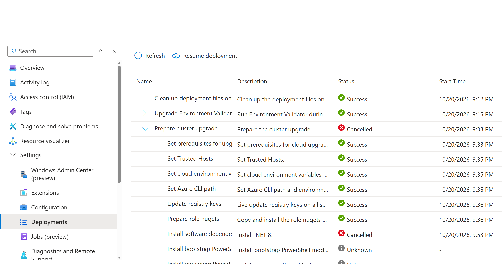
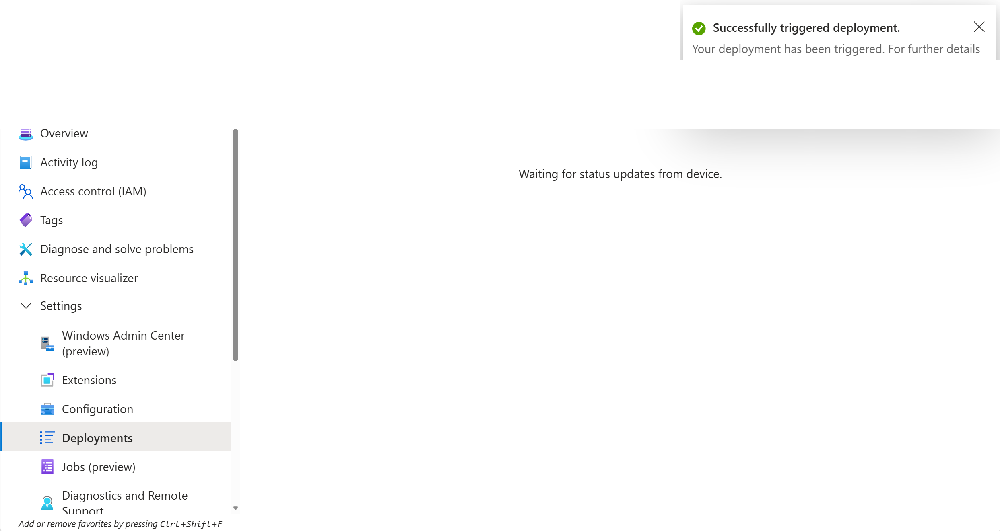
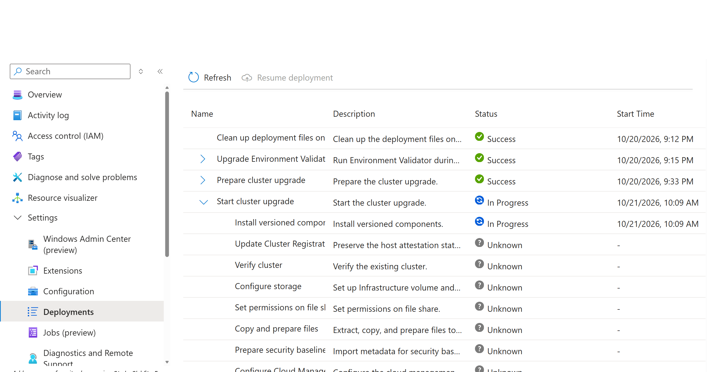

<!-- tsg-metadata
{
  "schema": "azure-local-supportability/tsg-metadata/v1",
  "document_type": "troubleshoot",
  "products": ["Azure Local"],
  "detector": {
    "type": "portal",
    "signal": "Azure Local resource > Deployments > Prepare cluster upgrade > Install software dependencies shows Cancelled during a solution upgrade."
  },
  "validation": {
    "fidelity_level": "L0",
    "technical_grade": null,
    "reproduction_substrate": "none",
    "automation_status": "manual",
    "last_validated": "2026-10-22",
    "spec_ref": ""
  }
}
-->

# Known issue: solution upgrade cancelled at Install software dependencies

## Table of contents

- [Applies to](#applies-to)
- [Symptoms and issue validation](#symptoms-and-issue-validation)
- [Where this appears](#where-this-appears)
- [Cause](#cause)
- [Mitigation](#mitigation)
- [Rollback and escalation](#rollback-and-escalation)
- [Prevent the issue on other clusters](#prevent-the-issue-on-other-clusters)
- [Related documentation](#related-documentation)

## Applies to

Azure Local solution upgrade interrupted when the **Install software dependencies** step installs PowerShell **7.6.7** and terminates the running PowerShell process.

Scope is connected, hyperconverged deployments. Applicability to disconnected, disaggregated, or multi-rack deployments has not been validated. This guide does not cover cancellations at other steps or failures with a different error. Contact Microsoft support for those scenarios.

**Impact and owner:** The solution upgrade is interrupted. The cluster administrator resumes the existing deployment within its approved upgrade maintenance window.

## Symptoms and issue validation

**[READ-ONLY]** Risk is not applicable because viewing deployment status does not change state.

In the Azure Local resource's **Deployments** blade, the upgrade stops during **Prepare cluster upgrade**. Expanding that stage shows:

| Stage or step | Status |
| --- | --- |
| Prepare cluster upgrade | Cancelled |
| Install software dependencies | Cancelled |
| Subsequent steps, such as Install bootstrap PowerShell modules | Unknown / not started |

Use the current status of the existing deployment, not an older notification. If the deployment is already progressing, continue monitoring instead of resuming it. If the cancelled step or error differs, stop and investigate that failure rather than applying this mitigation.

## Where this appears

The screenshots document the reported cancellation and recovery sequence. This article has received static review only; the other administrator surfaces below have not been characterized and remain publication-validation gaps. `absent` does not mean that the issue cannot appear on that surface.

## Cause

The **Install software dependencies** step installs PowerShell **7.6.7**. This installation requires terminating the running PowerShell process, which interrupts the upgrade attempt and causes it to appear as **Cancelled**.

The dependency step has already performed the PowerShell installation. For this known issue, customers do **not** need to manually install or reinstall 7.6.7, or run a node-side version check, before resuming the deployment. Selecting **Resume deployment** is sufficient to continue the upgrade.

The screenshots show cancellation followed by recovery after resuming; they do not independently establish the process-termination mechanism. That mechanism is the reported explanation for this issue, not a diagnosis for every cancelled upgrade.

## Mitigation

### 1. Resume the existing deployment

**[LOW RISK]** Resuming continues the solution upgrade. Before proceeding, confirm that the existing attempt matches the symptoms above, shows **Cancelled**, and the approved upgrade maintenance window and workload protections remain in place. The operator needs permission to resume the affected Azure Local deployment. Stop if these conditions are not met or the resume action is unavailable; contact Microsoft support.

Once the existing attempt shows **Cancelled**, open the affected **Azure Local** resource in the Azure portal, select **Deployments**, and select **Resume deployment**. No manual PowerShell installation is required.

> **Important:** Resume the existing attempt from the **Deployments** blade. Do not start another solution upgrade from the **Your cluster can be upgraded** banner.

The portal can display **Successfully triggered deployment** and temporarily show **Waiting for status updates from device**:

This notification confirms that the resume request was triggered; it does **not** mean that the upgrade has completed.

### 2. Confirm the cancelled stage recovers

**[READ-ONLY]** Risk is not applicable because this step only views deployment status.

Refresh the **Deployments** blade and verify that **Prepare cluster upgrade** changes to **Success** and the deployment advances to **Start cluster upgrade**.

This screenshot demonstrates recovery past the cancelled preparation stage, **not completion of the entire upgrade**. Continue monitoring until the full deployment completes successfully. If the stage remains cancelled or a new failure appears, use the escalation guidance below.

## Rollback and escalation

This guide does not provide a rollback for a resumed solution upgrade. Do not uninstall PowerShell or start a second upgrade as a rollback action.

If resuming does not recover the cancelled stage, do not repeatedly resume without investigating. Collect the latest **FullCloudUpgrade** logs from `C:\CloudDeployment\Logs`, the portal step/status details, and the time of the resume attempt, then open a Microsoft support case. Keep logs in the support case rather than posting environment details in a public issue.

## Prevent the issue on other clusters

If you manage multiple clusters and encounter this issue on one, you are likely to encounter it on other clusters that also need the PowerShell **7.6.7** dependency upgrade. To prevent the issue on those clusters, proactively install PowerShell **7.6.7** on **every node before starting their solution upgrade**. Follow the [pre-upgrade installation guide](./How-to-install-PowerShell-7.6.7-before-a-solution-upgrade.md).

For the cluster whose upgrade is already cancelled, select **Resume deployment**. Manual PowerShell installation is **not** required to resume that attempt.

## Related documentation

- [Install solution upgrade on Azure Local](https://learn.microsoft.com/azure/azure-local/upgrade/install-solution-upgrade)
